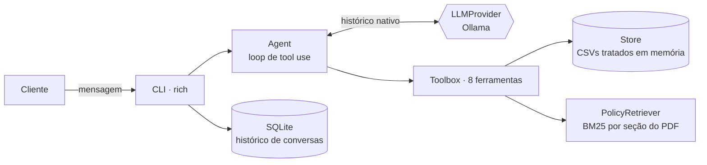

# Empório da Música — Agente de Atendimento

Protótipo de agente de atendimento por mensagens de texto para a **Empório da Música**,
loja fictícia de instrumentos musicais em Campo Grande/MS (desafio técnico AI Engineer —
Artefact).

A assistente virtual **Duda** responde clientes no tom da loja ("informal, mas
profissional"), consulta o catálogo, promoções e pedidos em tempo real, aplica as regras
do manual de políticas e recusa com gentileza o que está fora do escopo.

```
Você: Quanto custa o Takamine GD20?
  ↳ detalhes_produto({"nome": "Takamine GD20"})
Duda: O Takamine GD20 Dreadnought Natural custa R$ 2.199,00. É um violão dreadnought
      com tampo sólido em cedro... Está disponível aqui na loja!
```

Conversas completas em [`examples/`](examples/README.md).

---

## Sumário

1. [Como rodar](#como-rodar)
2. [Arquitetura](#arquitetura)
3. [Decisões técnicas](#decisões-técnicas)
4. [Tratamento dos dados](#tratamento-dos-dados)
5. [Suposições](#suposições)
6. [Limitações e próximos passos](#limitações-e-próximos-passos)
7. [Uso de assistentes de código](#uso-de-assistentes-de-código)

---

## Como rodar

Requisitos: Python 3.11+ e o [Ollama](https://ollama.com) (tabela abaixo).

### 1. Instalar

```bash
python -m venv .venv
```

```bash
# Windows: .venv\Scripts\activate   ·   Linux/macOS: source .venv/bin/activate
pip install -e ".[dev]"
```

(Com [uv](https://docs.astral.sh/uv/): `uv venv && uv pip install -e ".[dev]"`.)

### 2. Configurar o provedor

```bash
cp .env.example .env
```

| Provedor | Configuração no `.env` | Observação |
|---|---|---|
| **Ollama (local, grátis)** — padrão | `LLM_PROVIDER=ollama`, `OLLAMA_MODEL=qwen3.5:4b` | Instale o [Ollama](https://ollama.com) e rode `ollama pull qwen3.5:4b` (~3,3 GB). Os exemplos foram gerados assim. |

### 3. Conversar

```bash
emporio
```

Opções úteis:

| Comando | O que faz |
|---|---|
| `emporio --debug` | mostra as ferramentas chamadas em cada resposta |
| `emporio --hoje 2026-02-20` | simula a data atual (útil para testar prazos de devolução e horário) |
| `emporio --session <id>` | retoma uma conversa salva (o id aparece ao sair) |
| `emporio --listar` | lista as conversas salvas |

Outros comandos:

```bash
pytest
```

```bash
python -m emporio.data
```

```bash
python -m emporio.policies "posso parcelar em 10x?"
```

```bash
python scripts/gerar_exemplos.py --provider ollama
```

`pytest` roda os 43 testes (sem chamar LLM); `python -m emporio.data` imprime o relatório
de inconsistências dos dados; `python -m emporio.policies "<pergunta>"` mostra os trechos
do manual recuperados; `scripts/gerar_exemplos.py` regenera as conversas de `examples/`.

---

## Arquitetura



| Módulo | Responsabilidade |
|---|---|
| [`data.py`](src/emporio/data.py) | Carrega e trata os CSVs; consultas determinísticas (busca, preço final com promoção, verificação de cliente) |
| [`policies.py`](src/emporio/policies.py) | Extrai o PDF, divide por seção numerada e faz busca BM25 com expansão de consulta |
| [`tools.py`](src/emporio/tools.py) | As ferramentas expostas ao LLM (schemas + implementação) |
| [`prompts.py`](src/emporio/prompts.py) | Persona, regras e contexto dinâmico (data/hora, loja aberta ou fechada) |
| [`llm.py`](src/emporio/llm.py) | Provedor Ollama atrás de uma interface comum |
| [`agent.py`](src/emporio/agent.py) | Loop: LLM → ferramentas → LLM, até a resposta final |
| [`sessions.py`](src/emporio/sessions.py) / [`cli.py`](src/emporio/cli.py) | Persistência em SQLite e interface de terminal |

### Ferramentas

| Ferramenta | Quando o agente usa |
|---|---|
| `buscar_produtos` | perguntas abertas de catálogo ("violões até R$ 1.000", "ukulele elétrico") |
| `detalhes_produto` | um produto específico; se esgotado, já devolve alternativas parecidas |
| `listar_promocoes_ativas` | promoções, ofertas, "ainda está valendo?" |
| `simular_pagamento` | valor no PIX e parcelamento — contas feitas em Python, não pelo LLM |
| `consultar_pedido` | status/rastreio; exige nº do pedido **e** e-mail/telefone do cadastro |
| `verificar_troca_devolucao` | devolução, troca ou garantia de um pedido; calcula os prazos com a data de hoje |
| `consultar_politicas` | qualquer regra do manual (pagamento, frete, trocas, garantia, LGPD...) |
| `encaminhar_para_atendente` | reclamações e casos para humano (grava em `.sessions/handoffs.jsonl`) |

---

## Decisões técnicas

### Abordagem: function calling híbrido (dados estruturados + RAG leve)

O problema tem dois tipos de conhecimento com naturezas diferentes:

- **Dados operacionais** (preço, estoque, pedidos, promoções) são estruturados, mudam com
  frequência e exigem exatidão. O manual da loja diz literalmente: *"nunca fornecer
  informações sobre preços, estoque ou prazos sem consultar o sistema"*. Por isso viram
  **ferramentas determinísticas**: o LLM decide *quando* consultar e *com quais filtros*,
  mas o número vem do código.
- **Políticas** são texto. Viram uma ferramenta de **retrieval** sobre o manual.

Alternativas consideradas:

- **Agente de SQL (text-to-SQL)**: flexível, mas dá ao LLM poder de montar consultas
  arbitrárias sobre dados de clientes (risco de LGPD) e aumenta a chance de erro com
  modelos pequenos. As perguntas de atendimento são poucas e previsíveis; ferramentas com
  schema fechado cobrem todas com mais segurança.
- **Colocar tudo no prompt**: os dados cabem, mas preço e estoque ficariam congelados no
  prompt e o modelo faria filtros e contas "de cabeça".
- **Frameworks (LangChain, LlamaIndex)**: o loop de tool use tem ~30 linhas. Escrever à
  mão deixa o fluxo explícito, sem dependências pesadas e fácil de testar com um provedor
  falso (ver `tests/test_tools.py`).

**Lógica de negócio fica no código, não no prompt.** Ao rodar os cenários, o modelo local
errou contas de prazo (disse que um pedido *em transporte* estava fora do prazo de
arrependimento). Em vez de mais instruções no prompt, a regra virou a ferramenta
`verificar_troca_devolucao`. O mesmo vale para o PIX não cumulativo e as faixas de
parcelamento em `simular_pagamento`.

### Retrieval das políticas: chunk por seção + BM25

O manual é curto (8 páginas) e muito bem estruturado (seções numeradas como "4.1 Direito
de Arrependimento"). Decisões:

- **Chunk = subseção inteira**, extraída com `pypdf` em modo layout. Nenhuma regra é
  cortada ao meio, e cada trecho volta com a referência da seção.
- **BM25 em vez de embeddings**: com 25 chunks, busca lexical com stemming simples
  (prefixo de 5 letras: *devolver/devolução* → `devol`) e uma pequena **expansão de
  consulta** com sinônimos do domínio ("demora" → prazo, "Dourados" → outras cidades)
  acerta os 11 casos de teste de `tests/test_policies.py`, sem modelo de embeddings,
  sem banco vetorial e sem custo por consulta. A expansão nasceu de um erro real: a
  pergunta sobre entrega em Dourados recuperava só a seção da região metropolitana.
- **Fatos fixos no prompt**: endereço, telefone e horário são perguntados o tempo todo e
  não mudam — ficam direto no system prompt, sem custo de ferramenta.

### Modelo e provedor

O agente usa **Ollama + `qwen3.5:4b`**, 100% local ([`llm.py`](src/emporio/llm.py)):

- Gratuito, sem chave de API, roda numa GPU de consumo e suporta tool calling nativo.
  Foi o usado para gerar os exemplos. Comparei com um Qwen 3.5 9B disponível localmente
  no cenário de devolução e produto esgotado: ele não foi melhor e foi ~50% mais lento,
  então fiquei com o 4B.

### Estratégia de prompt

- **Persona** derivada do manual (seção 7.1): tom de "amigo que entende de música",
  mensagens curtas de chat.
- **Regra de ouro explícita**: nunca responder preço/estoque/pedido/política sem
  ferramenta; se a ferramenta não trouxer o dado, dizer que não sabe e oferecer atendente.
- **Situações especiais do manual (7.3)** viraram instruções: esgotado → alternativas;
  descontinuado → equivalentes; promoção vencida → transparência; reclamação →
  registrar e informar prazo de 24h úteis.
- **Escopo**: acessórios são redirecionados (a loja só vende instrumentos); assuntos
  alheios são recusados em uma frase; pedidos para ignorar as regras são ignorados.
- **Prompt em duas partes**: bloco estático (cacheável) + contexto dinâmico com data/hora
  de Campo Grande e se a loja está aberta, para o agente responder "estão abertos agora?"
  e aplicar prazos.

### Interface e persistência

- **CLI** com `rich`: o foco é o agente, e o terminal deixa ver as chamadas de ferramenta
  (`--debug`).
- **Histórico em SQLite** (`.sessions/conversas.db`): atendimento é naturalmente
  multi-turno ("Pedido 7" só faz sentido depois de "quero devolver") e o cliente pode
  voltar depois. O histórico é salvo no formato nativo do provedor, então a conversa é
  retomada com todo o contexto, incluindo resultados de ferramentas.

### Segurança e LGPD

- Consulta de pedido exige número **e** e-mail/telefone do cadastro; a resposta é a mesma
  para "pedido não existe" e "dados não conferem" (não vaza quais pedidos existem).
- As ferramentas nunca devolvem e-mail, telefone ou nome completo do cliente — só o
  primeiro nome, para a saudação.
- O modelo local às vezes copiava o telefone com um dígito a menos ao montar a chamada; a
  verificação também confere os contatos extraídos literalmente do texto do cliente
  (teste garante que isso não libera pedido de outra pessoa).

---

## Tratamento dos dados

Ao carregar os CSVs ([`data.py`](src/emporio/data.py)) o agente trata e reporta
inconsistências (`python -m emporio.data`):

| Problema encontrado | Tratamento |
|---|---|
| Descrições que citam **outra marca** (ex.: "Music Man Bass 1X" descrito como Fender Jazz Bass; "Bateria Pearl Kit 2" descrita como Tama) — 6 produtos | Descrição suprimida; o agente fala só de nome, preço e especificações |
| Produto ativo com estoque zero (Giannini GF-3D) | Tratado como indisponível; alternativas sugeridas |
| Produtos `discontinued` e `coming_soon` | Nunca aparecem como disponíveis |
| Promoções duplicadas por produto e inativas | Só `is_active = 1` vale; havendo mais de uma ativa, fica a de maior desconto (não cumulativas) |
| Pedidos 3 e 20 com total diferente da soma dos itens a preço atual | Mantido o total registrado (pode ter havido desconto na época); reportado na auditoria |
| Nenhuma data real de entrega nos pedidos | Usa-se a previsão de entrega como aproximação, e o agente avisa que a data é aproximada |
| E-mail com acento no manual (`empóriodamusica`) x capa sem acento | Corrigido para `contato@emporiodamusica.com.br` |
| Busca por "violão" trazia um ukulele pela descrição ("uma ponte entre o ukulele e o violão") | Busca só em nome, categoria e especificações |

---

## Suposições

- **Telefone/WhatsApp**: o manual cita (67) 3341-4444 (capa e tabela 1.2) e (67) 3321-4500
  (seção 7). Adotei **3341-4444**, que aparece em dois lugares e na tabela de dados da
  empresa.
- **Data dos dados**: os pedidos vão até março/2026 e vários estão "pendentes" ou
  "enviados" com previsão de entrega já vencida. O agente usa a data real por padrão; para
  demonstrar prazos de política, os exemplos usam `--hoje`.
- **Direito de arrependimento** vale para compras online (como diz o manual); assumo que
  os pedidos do sistema são online.
- **Troca por preferência**: o manual diz "em até 7 dias" sem dizer a partir de quando;
  assumi a partir do recebimento, como o arrependimento.
- **Feriados** não estão modelados no cálculo de "loja aberta".
- **Parcelamento**: "até 3x sem valor mínimo (exceto abaixo de R$ 50,00)" foi lido como
  parcela mínima de R$ 50 nessa faixa.
- O agente **não fecha vendas nem reserva produtos**: orienta a ir à loja ou falar com a
  equipe. Frete para outras cidades não tem tabela nos dados, então o agente explica a
  política e diz que o valor é informado no fechamento.

---

## Limitações e próximos passos

**Limitações conhecidas**

- Com o modelo local de 4B ainda aparecem deslizes de seguimento de instrução (chamar o
  cliente pelo nome da assistente, informar estoque exato, prometer algo que não existe).
  Estão listados, sem maquiagem, em [`examples/README.md`](examples/README.md).
- A expansão de consulta do retrieval é uma lista manual; não generaliza para vocabulário
  muito diferente.
- Os CSVs são lidos uma vez na inicialização (é um protótipo; em produção seriam consultas
  ao banco/ERP).
- Sem detecção de feriados, sem cálculo de frete por CEP, sem integração real com
  WhatsApp.

**Com mais tempo eu faria**

1. **Avaliação automatizada**: um conjunto de ~50 perguntas com respostas esperadas
   (chamada de ferramenta correta + fatos na resposta), rodando a cada mudança de prompt
   ou modelo, para comparar modelos locais (4B, 9B, outros) com números em vez de impressão.
2. **Guardrail de saída**: checagem determinística pós-resposta (ex.: todo `R$` citado
   existe no retorno das ferramentas; nenhum dado pessoal na resposta).
3. Embeddings + BM25 (busca híbrida) se o manual crescer.
4. Integração com WhatsApp (webhook) e API HTTP (FastAPI) com sessão por telefone.
5. Handoff real para a equipe (fila/ticket) em vez de um arquivo JSONL, e observabilidade
   (log estruturado de cada chamada de ferramenta, latência e custo).

---

## Uso de assistentes de código

> **Nota para o candidato:** esta seção descreve o fluxo usado nesta sessão; revise e
> ajuste com suas próprias palavras antes de entregar.

Usei o **Claude Code** (app desktop, modelo Claude Opus 5.5) como par de programação
durante todo o projeto. Fluxo:

1. **Leitura e planejamento**: o assistente leu o enunciado, o manual em PDF e todos os
   CSVs, apontou inconsistências nos dados e propôs a arquitetura (function calling +
   retrieval por seção). As decisões que dependiam de mim — provedor de LLM (Ollama
   local, gerando os exemplos localmente) e manter o repositório só local até
   a revisão — foram perguntadas antes de começar.
2. **Desenvolvimento incremental em branches**: uma branch por etapa
   (`feature/data-layer`, `feature/policy-retrieval`, `feature/agent-core`,
   `feature/cli`, `docs/examples-readme`), cada uma com testes e mesclada na `main` com
   `--no-ff`, para o histórico mostrar o progresso real.
3. **Testes como rede de segurança**: cada módulo foi escrito junto com testes `pytest`
   que não dependem de LLM (incluindo um provedor falso para testar o loop do agente).
4. **Iteração guiada por execução real**: os cenários de exemplo foram rodados contra o
   modelo local, as respostas revisadas contra os dados, e cada erro encontrado virou um
   commit `fix(...)` com a causa descrita na mensagem (resposta vazia, telefone
   transcrito errado, retrieval de frete, prazo de devolução).

---

## Estrutura

```
├── data/                    # CSVs e manual de políticas fornecidos pela loja
├── examples/                # 5 conversas reais + análise crítica
├── scripts/gerar_exemplos.py
├── src/emporio/
│   ├── agent.py  cli.py  data.py  llm.py  policies.py  prompts.py  sessions.py  tools.py
└── tests/                   # 43 testes (dados, retrieval, ferramentas, loop, sessões)
```
